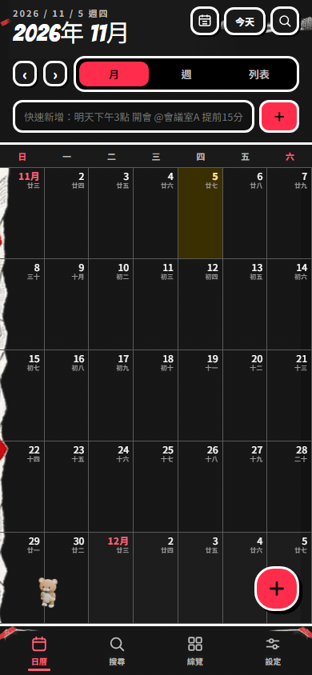

# 三款新夥伴的前景活動（DP-240）

2026-11-05。接 DP-239 可保存的選擇，讓棉花貓、蜂蜜熊、蜜桃兔使用 DP-238 的真正 Blender walk／sit／sleep 素材自主活動；月光貓與軌道噗保留原五態行為。此分支沒有重畫或替換素材。

## 行為與位置

符合前景條件後等 8–12 秒，選取一小段直線散步，以約 22px／秒前進；途中每幀只更新控制項 transform，不逐幀重畫 React。停下後 idle 或 sit；前景沒有輸入 120 秒後睡覺，輸入再喚醒。走向左側時只鏡射美術，按鈕、徽章與可存取名稱保留。

`planPetWalk` 沿既有安全範圍／60px footprint，檢查整段移動的 swept rectangle，避免只檢查端點卻穿過 FAB。最多嘗試八條路徑，空間不足時坐下；不越過 header／分頁或移出 viewport。真正手動 anchor 沿既有 ratio 保存，散步位置只在記憶體；切分頁／收起再展開回到手動位置。

滑鼠靠近或按鈕持有焦點時停止，實際檢查 DOM 焦點以涵蓋收起／展開時沿用同一按鈕的情況。pointerdown 在 capture 階段先停在當前影格，拖移以 preview 的實際點開始，不跳回 anchor。長按與多指接觸持續暫停，最後一指放開／cancel 才重新等待。沒有攔截單指捲動、click 或鍵盤預設行為。

拖曳／鍵盤移動、泡泡、其他表單、收起、背景、沒有有效幾何與 reduced-motion 均停止自動活動；移除 timer／RAF／listeners，回前景重新等待，不補播背景期間的路程。原互動引起的 look／完成待辦 jump 與靜態 fallback 保留。關閉顯示夥伴仍卸載整層。

## 驗證與限制

- 新 16 個單元驗路徑、連續 100 個位置的安全範圍、FAB 兩個安全端點之間不可穿越、有限重試、真實中間點／不逐幀 React render、120 秒睡眠、輸入、長按／多指、StrictMode／卸載、背景與 live reduced-motion、已保留焦點的重用按鈕／hover 無輪詢。
- 完整 **1,833 單元／105 檔＋41 Node** 通過，實際 Etc/GMT-8。第一輪在同時 build 的本機負載下有四個既有 5 秒逾時；原期限重跑四檔 43 項全過，再停止併行 build 獨立全套通過，沒有放寬 timeout／worker／retry 或 CI。
- 最新三平台矩陣 **5 passed／2 skipped**：手機三款真的移動且有 walk 圖、核心流程在手機／桌面 Chromium 與 WebKit 均過；拖曳 30px 的精確交接、原資料 bytes、手動位置不被活動寫掉、表單／輸入／reduce／睡眠／長按、收起／展開焦點及回分頁恢復。兩項略過是桌面的重複素材案例。
- 路線 RNG 固定為 0、時計可快進以覆蓋長等待；幾何、DOM、原生滑鼠、圖片與 compositor 是實際瀏覽器。背景邏輯以單元的 document.hidden 替身驗證，未宣稱真實 iPhone 切背景、耗電或系統手勢已驗。實際 browser Asia/Taipei。三張手機／桌面／WebKit 截圖已目視，console 原有零錯誤守門保留。
- 首輪拖移 fixture 在停穩前取座標造成不到一像素差異，改成停穩並對準實際滑鼠點；桌面 preview 捲動的絕對座標改為日曆內相對座標，沿既有 placement 契約。新增收起／展開測試後真正抓到 Chromium 保留焦點不再次觸發 React focus 的問題；改用實際 DOM 焦點／事件並新增回歸後，完整七項矩陣才通過。沒有用放寬位置容差掩蓋。

Pages production build／TypeScript、check:build 通過，JS＋worker **803,665 raw／237,756 gzip**、CSS **121,885／29,785**，原預算／CSP 不變；素材 bytes 與 Blender provenance 沿 DP-238。lint／typecheck 在本次提交前再確認。此段沒有 schema／migration／Auth／提醒服務或版號變更；新 v5 偏好 migration 的正式前置仍沿 DP-239。

## 接手狀態

候選接 `feat/dp-239-pet-choice`，自己的最新四 CI／同 head 完成審查仍須通過，未合併／發布。11-05 擁有者另請網頁版繼續三款 Blender 造型；本機先保存可重用的活動與位置契約，後續依其真正提交整合素材，避免覆寫雙方工作。分支與發布界線見 [交接](pet-handoff-2026-11-05.md)。
