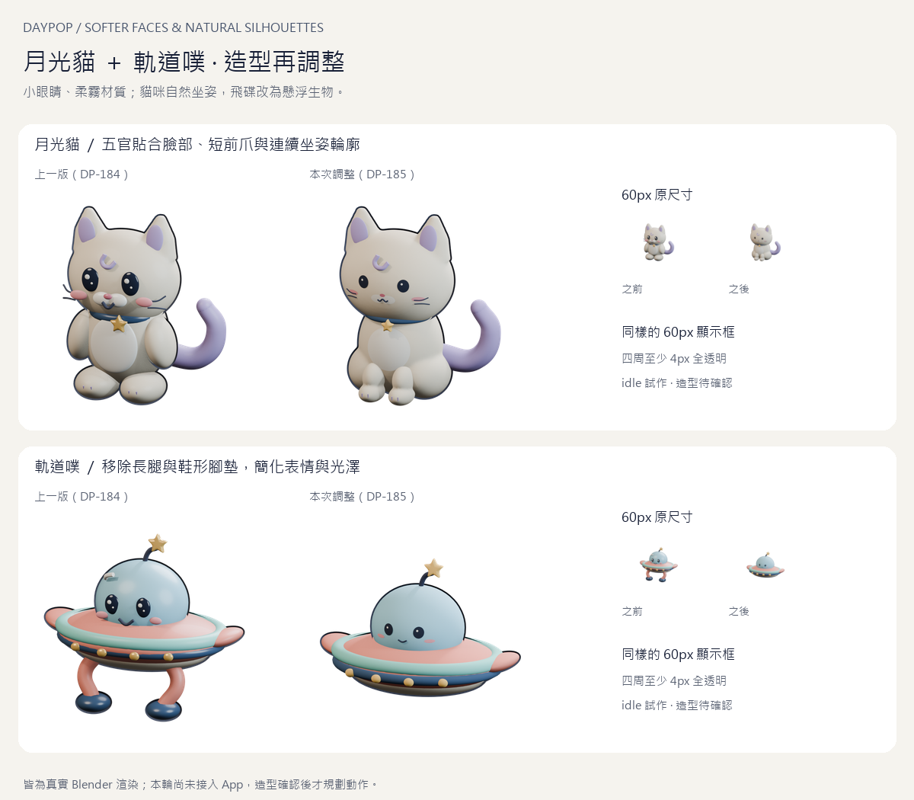
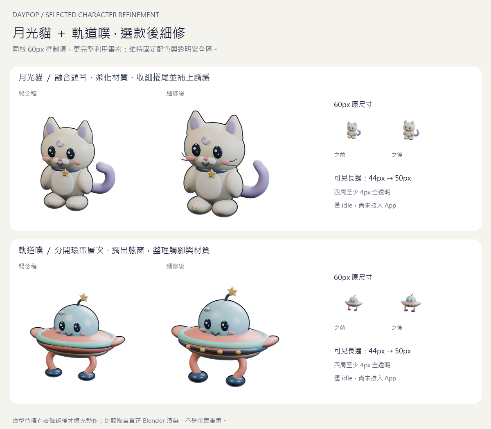
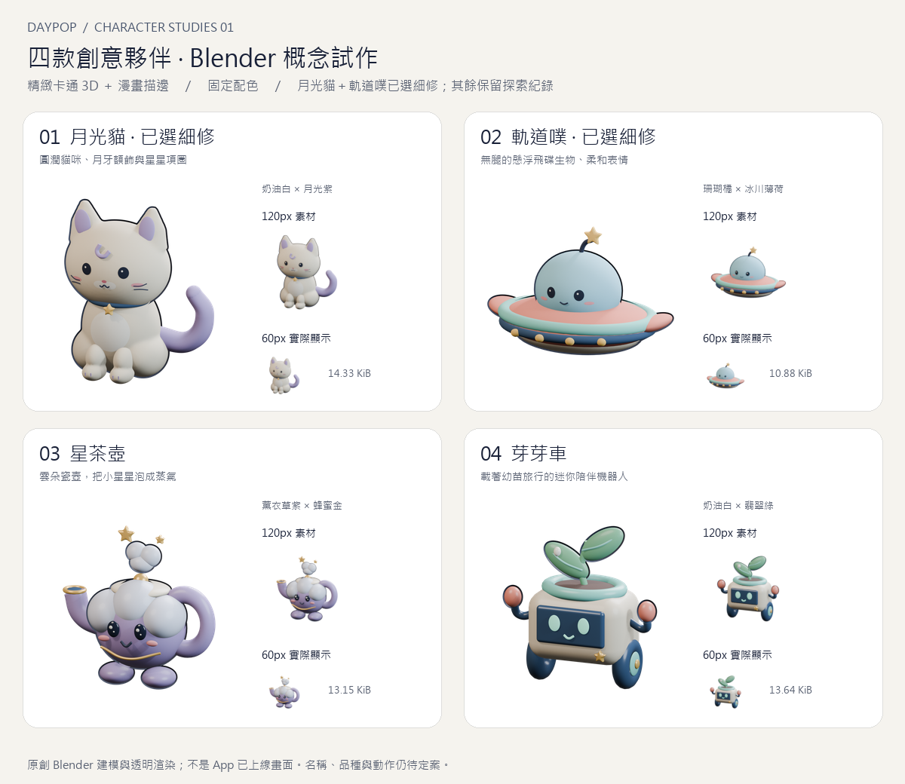
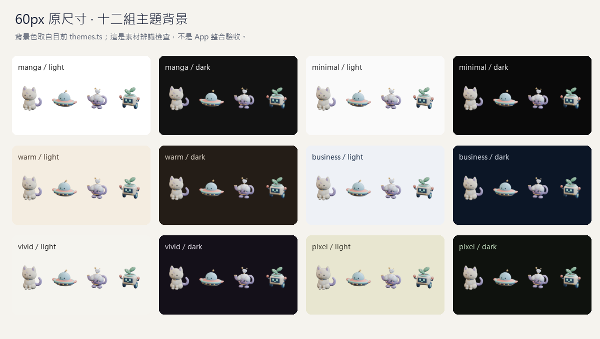

# Blender 創意夥伴概念試作（DP-183）

> **sit 試作（DP-202，2026-10-25）：** [兩款放鬆靜態姿勢與 walk 可行性](../2026-10-25/sit/README.md) 另交原生 Blender／真實 PNG／RGB128／120與60px 比較，造型／材質／相機沿用；十五項圖片與 native 負控制、重渲染逐像素一致。只是候選，未接 App、sit 品質待擁有者驗收；貓後肢融合的模型限制與未完成 walk 有明確記錄。

> **循環編碼接入（DP-201，2026-10-25）：** [App 採用與驗證](../../pet-loop-encoding-adoption.md) 已採四張 Q75／A100 idle／sleep，原 20 decoded frames／phase／4.4 秒及 matched alpha=0 保留，五態包 174,308／152,194 bytes；本目錄原幀／Blender／動畫不改。下方候選未採用為 DP-200 當時歷史，擁有者品質與七態仍未完成。

> **循環動畫參數評估（DP-200，2026-10-25）：** [16 候選與相同時間點比較](../2026-10-25/loop-encoding/README.md) 保留目前 idle／sleep phase，保守建議 Q75／A100、matched alpha=0；Q35 雖數值合格，陰影斑駁不作建議。假設五態包 174,308／152,194 bytes，尚未採用、不保證七態，原 Blender／PNG／動畫不改，擁有者品質仍待驗收。

> **靜態 PNG 接入（DP-199，2026-10-25）：** [App 採用與實檔驗證](../../pet-static-png-adoption.md) 已採 DP-198 六張 RGB128 PNG，原 alpha 不變，五態包 190,980／167,288 bytes；本目錄母 PNG／Blender 與動畫不改。色彩品質仍待擁有者目視確認、七態未完成；下方未換圖為 DP-198 評估當時歷史。

> **靜態 PNG 編碼評估（DP-198，2026-10-25）：** [24 候選與透明度比較](../2026-10-25/static-encoding/README.md) 建議保留原 alpha 的 RGB128，假設五態包 190,980／167,288 bytes；索引圖因 alpha／安全區問題不採。App 與本目錄來源尚未換圖，PNG 色彩品質仍待擁有者目視確認，七態預算未完成。

> **完成回饋接線（DP-197，2026-10-25）：** 待辦確認完成後可播單次 jump；取消／失敗／跨頁／帳號／暫藏不補播，不新增 XP／稱讚泡泡。圖片與每款預算不改，詳 [生命週期與驗證](../../pet-completion-feedback.md)。本目錄原始概念／Blender 仍不變，新動作品質尚待擁有者目視驗收，七態未完成。

> **jump 候選 registry 接入（DP-196，2026-10-25）：** 兩張完整十幀 WebP 已接 typed registry，靜態共用既有 idle PNG，五態七實檔為 196,286／173,845 bytes；App 仍觸發四態，jump cue 尚未接線。詳見 [接入與驗證](../../pet-assets-integration.md)。原始概念／Blender 不變，新動作品質仍待擁有者目視確認，尚未完成七態。

> **jump 編碼評估（DP-195，2026-10-24）：** [完整十幀候選與淺深底對照](../2026-10-24/jump-encoding/README.md) 建議貓 Q55/A70、飛碟保留原 Q85，共用 idle PNG 五態為 196,286／173,845 bytes；減樣方案因逐時間點差異超標不採用。App 尚未採候選，下一段只接 registry；不代表新動作已經擁有者目視驗收或七態預算已完成。

> **jump 素材試作（DP-194，2026-10-24）：** 另交兩款 1 秒單次的小幅蓄力／輕躍／回原 idle，見 [原生來源、預覽與驗收](../2026-10-24/jump/README.md)。動作品質仍待擁有者目視確認；貓加入後仍超既有 192 KiB，下一段先做編碼評估，App 圖片包不變。sleep 已由 DP-192／193 接入四態與前景閒置政策，詳見 [最新播放紀錄](../../pet-idle-sleep.md)；下方各階段狀態保留為歷史。

> **sleep 素材試作（DP-190，2026-10-24）：** 沿已採用兩款造型，另交原生閉眼／緩慢呼吸的 4.4 秒循環、Blender、透明幀與候選量測，見 [sleep 預覽與驗收](../2026-10-24/sleep/README.md)。本頁及三態舊檔不變；新動作尚未經擁有者目視驗收，未接 App，直接加包會超過既有 192 KiB，下一段先做編碼評估。

> **三態已接入（DP-188，2026-10-23）：** 預設月光貓已使用 DP-187 的 Q85 WebP＋PNG，飛碟只登記 registry，採每款 192 KiB 的圖片預算；詳細播放／離線／驗證限制見 [接入紀錄](../../pet-assets-integration.md)。本頁素材與 Blender 原檔保持原樣，下方未接 App／預算未定的文字保留為各階段歷史。

> **三態已試作（DP-187，2026-10-23）：** 擁有者明確要求由本 agent 接回，完成兩款 idle／look／grab 的 Blender 控制／shape-key 來源、122 張透明幀、六張靜態替代與候選編碼量測。最新看 [三態預覽與製作紀錄](motion/README.md)；本頁的 DP-185 原檔／靜態圖保持不變，App 尚未接素材，後四態／格式與預算仍待定。

> **交接更新（DP-186，2026-10-23）：** 擁有者已採用 DP-185 造型，並定案兩款先做 `idle／look／grab` 三態；隨後要求先交接給另一個 agent，**動畫尚未開始**。以下「待確認」保留為交付時的歷史狀態；接手以 [三態素材交接](../../pet-motion-handoff-2026-10-23.md) 的最新定案、PR／CI／工具路徑與邊界為準。

2026-10-23 擁有者要求使用 Blender 製作精緻角色，明確指出摩卡只是粗糙範例；選擇「精緻卡通 3D＋漫畫描邊」與固定配色。只保留貓咪為必須項，其餘由 Codex 提案，不再預設全部是動物，太空船生物也是可探索方向。圖片體積預算先保留，待試作量測後定案。

本目錄交付四款 **idle 概念**、可編輯來源與實際尺寸檢查，不是正式 App 素材、不代表四款都獲選，也沒有完成七種動作、動畫、rig 或狀態機。舊 `cat / bear / bunny / chick` 是先前規劃；本次新 id 只用於概念檔案，不是新偏好欄位或正式 registry key。

## 最新：柔和五官與自然姿態（DP-185）

擁有者看過 DP-184 後認為「有點詭異，需要調整」，明確採納兩款一起改：貓縮小眼睛、減少反光，鼻嘴融入臉部，短肢自然坐姿；飛碟移除長腿與鞋形腳墊，改成懸浮生物並簡化表情；兩款降低塑膠光澤、整理接縫，保留固定配色與 3D 漫畫風。這是修改方向的確認，**不是新造型已驗收**。本次仍只交付 idle，造型再次確認後才規劃動作。



`friendly_selected.py` 在既有建模階段上增量調整：貓的眼／鼻嘴／腮紅以細分淺面貼合實際頭部曲面，保留每眼一個小亮點；坐姿軀幹與後腿融合、前爪接地並融合腳掌接縫，腹部白毛也貼合曲面。飛碟刪除全部腿／腳墊與玻璃反光條，簡化五官，整理環帶與既有舷窗。兩款沿用原色值、燈光及透明取景流程，提高 roughness、降低 coat／specular 來減少反光，沒有改成平面重畫或加入地面陰影／光束。

| 本次量測 | 月光貓 | 軌道噗 | 兩款合計 |
| --- | ---: | ---: | ---: |
| 120px PNG bytes | 14,669 | 11,143 | 25,812（25.21 KiB） |
| 60px PNG bytes | 5,525 | 4,194 | 9,719（9.49 KiB） |
| 120／60px 可見長邊 | 99／50px | 100／50px | 四周至少 8／4px 透明 |

無腿飛碟的輪廓較扁：120px bounds `[10,26,109,94]`、60px `[5,13,54,47]`；沒有為了湊高度拉長模型。四款最新 120px 合計 53,248 bytes、60px 合計 19,818 bytes。仍只是靜態量測，**32 KiB／224 KiB 預算、動畫格式及快取未定案**。

新增 `test_friendly_sources.py` 用 Blender 打開真正的 `.blend`，量眼／頭比例、鼻嘴曲面深度、前爪長度與接地、飛碟下腹以下的實際幾何，以及材質反光參數。四組在 DP-184 全部先失敗；完成後暫換回該 commit 的兩份真實原檔，四組再次失敗，finally 逐 byte 恢復後通過。曲線以 evaluated mesh 頂點量測，避免保守 bounding box 把微笑誤當下垂零件。這些只能驗證已同意的可量化變更，不能替代主觀美術驗收。

既有六項壞圖／真實檔移除負控制、四組占比反向驗收、alpha／bytes／hash 與十二背景檢查均保留。來源再次實際重開：36／30／41／33 objects，無外部貼圖；其他兩款來源／所有 PNG、DP-184 的比較圖逐 byte 不變。`make_selected_board.py` 用 Git 保留 DP-183 → DP-184 的歷史比較；新比較以 `0cd76de` 的真正 PNG 對照最新渲染，重跑兩者不混用版本。

本段重新實跑 lint／typecheck、87 檔 1,365 單元＋17 Node、build／check:build、相關 Chromium／WebKit 9 passed。build／e2e 的 Node 子環境明確設空 Supabase URL／publishable key（均印出 length 0），實際 Node Etc/GMT-8／browser Asia/Taipei 均列印；背景伺服器依監聽埠／命令列核對後停止。JS 742,203 raw／218,446 gzip、CSS 112,159 raw／27,225 gzip bytes 與前段相同，概念資產未進 dist。離線 Blender／Python 驗收本機執行，未新增 CI 相依；PR 四項最新 CI 全過、審查後才依既有授權合併。

## 歷史：選款後細修（DP-184）

擁有者看圖後選擇先細修「月光貓＋軌道噗」，**造型確認後才擴充動作**。PR #178 的概念基線為 `f51dd605bafd502fbf8ec2c8a5a5d589ea70b9e7`；以下比較從該 commit 的真正 PNG 與本次 Blender 輸出組成，不是示意重畫。其他兩款的 PNG／`.blend` 逐 byte 不變。



貓以 Boolean／voxel remesh 融合頭耳，消除獨立描邊殼在耳根的鋸齒接縫；保留紫耳與月牙，柔化材質、收細圓尾並增加鬍鬚。飛碟整理互相重疊的環帶、將被遮住的四個舷窗移到外殼正面，並調整觸腳墊與材質粗糙度。兩款的主配色、角色辨識、尺寸與背景透明規則保留；沒有加燈光特效、動畫或狀態。

相機改為更完整利用畫布；兩款在 60px 裡的可見長邊 **44px → 50px**，120px 為貓 99px／飛碟 100px，四周仍至少 4／8px 全透明。這是像素占比，不是字級或控制項變大，也不能代替主觀造型確認。新增驗收要求長邊至少占 80%，原始四組尺寸全部失敗；完成後反向換回真正的原始 PNG，再取得四個失敗，finally 逐 byte 恢復後通過，原先六項壞圖／移除負控制仍通過。

DP-184 當時兩款 120px 合計 **30,209 bytes（29.50 KiB）**、60px 合計 **11,078 bytes（10.82 KiB）**；圖片預算仍未定案。當時尚未做動畫、rig、完整七態、正式 keys／偏好或 App 接入；後續收到調整造型的回覆，接續上方 DP-185，沒有進入動作規劃。

本段重新實跑 lint／typecheck、1,365 單元＋17 Node、build／check:build、相關 Chromium／WebKit 9 passed，四份 `.blend` 再次重開、六項負控制與新增占比／反向驗收均過。build／e2e 明確使用空 Supabase 子環境，Node Etc/GMT-8／browser Asia/Taipei 均列印，JS／CSS bytes 沿下方既有量測不變；背景伺服器已核對並清理。最新 PR 四項 CI 全過與審查完成後才依既有授權合併。



| 概念 | 造型提案 | 768px 透明圖 | Blender 原檔 | 120px PNG | 60px PNG |
| --- | --- | --- | --- | ---: | ---: |
| 月光貓 `moon_cat` | 奶油白、月光紫、月牙額飾與星星項圈；DP-185 改成淺面五官、短前爪自然坐姿。 | [大圖](renders/moon_cat-768.png) | [可編輯 .blend](source/moon_cat.blend) | 14,669 bytes | 5,525 bytes |
| 軌道噗 `orbit_ufo` | 藍色頭罩、薄荷環、珊瑚外殼與星星感覺器；DP-185 改成無腿懸浮生物。 | [大圖](renders/orbit_ufo-768.png) | [可編輯 .blend](source/orbit_ufo.blend) | 11,143 bytes | 4,194 bytes |
| 星茶壺 `cloud_teapot` | 雲朵瓷壺、蜂蜜金壺口、彎嘴、把手，蒸氣裡冒出小星星。 | [大圖](renders/cloud_teapot-768.png) | [可編輯 .blend](source/cloud_teapot.blend) | 13,468 bytes | 4,965 bytes |
| 芽芽車 `sprout_rover` | 植物與機器人的混合；螢幕表情、輪腳、珊瑚手套、土壤與帶露珠的幼苗。 | [大圖](renders/sprout_rover-768.png) | [可編輯 .blend](source/sprout_rover.blend) | 13,968 bytes | 5,134 bytes |

DP-184 當時 120px 四款合計 **57,645 bytes（56.29 KiB）**，60px 合計 **21,177 bytes（20.68 KiB）**；DP-185 最新量測見上節。DP-183 原始四款當時是 53,514／19,723 bytes，每次只更新已選兩款。這只是靜態 idle 的實測值，不能外推動畫、七態總包、下載成本或真機解碼時間。原先每張 32 KiB／七張 224 KiB 都尚未定案，沒有加入 `performance-budget.json`。

## 可重跑來源

實際使用 [Blender 官方 5.2.3 Windows portable](https://download.blender.org/release/Blender5.2/)；依同目錄官方 `blender-5.2.3.sha256` 核對 zip：

```text
723f08a4401502561eb763cdeacf8745b31e5f3f154d287d3830d97cf75dc2fb
```

工具解壓於本機系統暫存目錄，不提交 Blender 執行檔、不改系統設定。原檔由本目錄的 `create_concepts.py` 使用可編輯 meshes、curves、命名材質與三盞柔光建成，沒有外部模型、貼圖或生成圖片。概念板只把實際 Blender 渲染排版，沒有另外重畫或修飾角色。

在 repo 根目錄執行（PowerShell，路徑改成自己安裝的 Blender）：

```powershell
$petBlender = 'C:\path\to\blender.exe'
& $petBlender --background --factory-startup --python-exit-code 1 --python docs/pet-concepts/2026-10-23/create_concepts.py
& $petBlender --background --factory-startup --python-exit-code 1 --python docs/pet-concepts/2026-10-23/refine_selected.py
& $petBlender --background --factory-startup --python-exit-code 1 --python docs/pet-concepts/2026-10-23/friendly_selected.py
& $petBlender --background --factory-startup --disable-autoexec --python-exit-code 1 --python docs/pet-concepts/2026-10-23/test_friendly_sources.py -- --reverse-control
& $petBlender --background --factory-startup --disable-autoexec --python-exit-code 1 --python docs/pet-concepts/2026-10-23/check_sources.py
py docs/pet-concepts/2026-10-23/check_assets.py
py docs/pet-concepts/2026-10-23/test_asset_checks.py
py docs/pet-concepts/2026-10-23/test_selected_sprites.py --reverse-control
py docs/pet-concepts/2026-10-23/make_board.py
py docs/pet-concepts/2026-10-23/make_selected_board.py
py docs/pet-concepts/2026-10-23/make_friendly_board.py
```

`create_concepts.py` 重建原始四款，`refine_selected.py` 重建 DP-184；目前版本最後必須執行 `friendly_selected.py`，它重用兩個歷史階段，只更新貓／飛碟。只需重建兩款時可直接執行最新階段。前後比較與反向驗證需本機 Git 有 `f51dd60`／`0cd76de`；shallow clone 需先取得兩個 commit。反向驗收暫換真實產物，需逐條執行，不要與繪板／hash 或其他驗收平行跑。

`check_assets.py`、`test_selected_sprites.py` 只需 Python standard library；`test_asset_checks.py` 與兩支概念板工具需要 Pillow，本機 Python 3.12.3 已有。概念板使用本機 Windows `msjh.ttc`，字體檔不隨 repo 散布，其他作業系統需自行指定支援中文的字體。這些是離線概念工具，不是 App 相依或 npm build 的一部分；沒有新增 CI 執行它們的步驟。檔案 SHA-256、尺寸、非透明範圍與 bytes 見 `manifest.json`。Blender 可能因 GPU／版本／取樣產生少量像素差異；重建會重新量測與更新雜湊，不能承諾逐 byte 可再現。

四份壓縮 `.blend` 均已由官方 Blender 重開：目前分別 36／30／41／33 個 objects（DP-184 為 44／39／41／33），可編輯 meshes／curves／材質，沒有外部貼圖。相機為正交、背景透明，輸出路徑相對於 source 指向 `../renders/`。相機先依實際 alpha 輪廓取景，避免只看保守幾何 bounds 造成角色過小；曲線端點封閉，描邊殼不投影，避免首輪自陰影雜訊。

## 驗收與限制

- 先寫 acceptance checker，缺少產物時失敗。第一輪也抓出取景過小，沒有降低非透明面積門檻。
- 最終八張 120／60px PNG 皆為 8-bit RGBA、四周至少 8／4px 全透明，不是白底；不是空圖，保留材質色階。每款各自取景，**跨動作腳底 registration 尚未定案**，不得直接當成完整七態。
- 六項負控制通過：空圖、白底、幾乎透明但被裁切的邊緣、失去材質的剪影、錯誤尺寸均被拒絕；暫時移除真正交付的貓咪 120px 檔會失敗，finally 逐 byte 還原後完整 checker 再通過。
- 十二組背景的 60px 圖已實際查看；主要輪廓與表情可辨識，星星、腳趾等細節在 60px 會簡化，後續選定造型還需調整。`theme-backgrounds.json` 是本次從 `src/theme/themes.ts` 取出的 bg／fg 快照，不是另一份產品色盤。
- [背景檢查圖](theme-check.png) 是靜態素材辨識檢查，沒有把新角色放進 App；不能當成 axe、整體 UI 或 iOS 真機驗收。描邊寬度、動畫、所有姿勢的一致腳底與 reduced-motion 靜態替代，留到造型選定後處理。

專案驗證：lint、typecheck、87 檔 1,365 單元＋17 Node、build／check:build 全過；相關 Chromium 手機／桌面夥伴操作與 WebKit smoke 共 9 passed。本機 Vitest 最初 sandbox 啟動時 `spawn EPERM`、未執行案例，同指令在可啟動子程序的環境通過（`--maxWorkers=2 --testTimeout=30000`，CI 不改）。build／e2e 的 Node 子環境明確設空 Supabase URL／publishable key；Node 印出 Etc/GMT-8，browser 印出 Asia/Taipei。JS 742,203 raw／218,446 gzip、CSS 112,159 raw／27,225 gzip bytes，沿原有預算；概念圖未進 dist。測試伺服器 PID／命令列已核對並清理。最新 PR 四項 CI 全過後才依既有授權合併，CI 結果見 PR。



DP-183 當時建議先細修「月光貓＋軌道噗」，擁有者已採用；接續 DP-184／DP-185 成果見上方，新造型仍待再次確認。正式造型確認、名稱／keys、狀態觸發、動畫格式、圖片預算及快取／預載仍待定案；DP-171、DP-172、DP-041 均未結案。App 0.4.3、資料 v4、18 migrations、公告及部署不變，沒有 Supabase MCP 或正式使用者資料操作。
