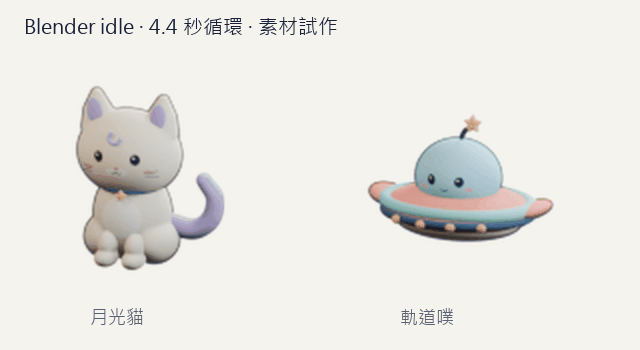
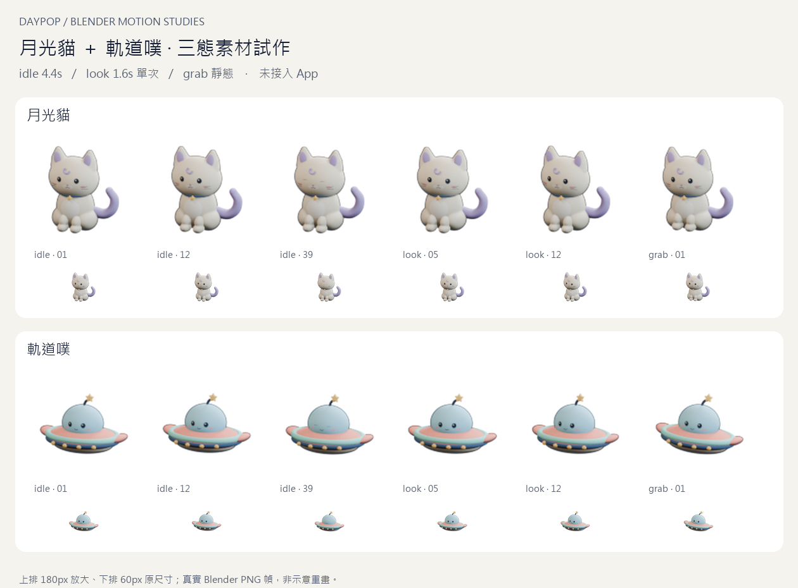
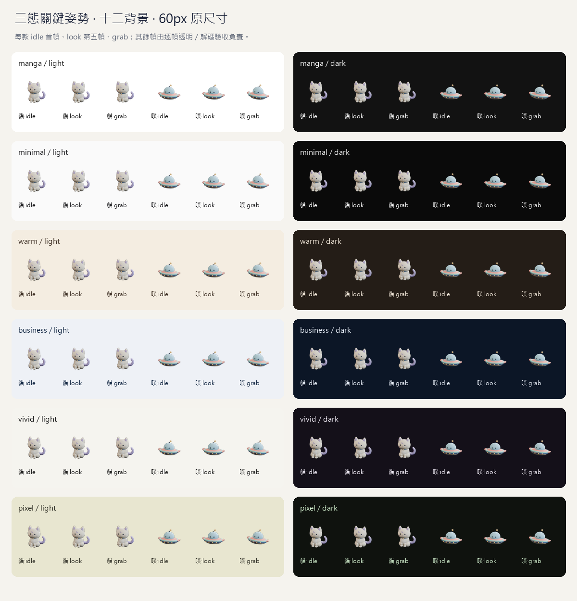

# 月光貓＋軌道噗三態素材試作（DP-187，2026-10-23）

> **2026-10-23 接入補充（DP-188）：** 本頁仍保存試作時的原始量測。後續已採 Q85 WebP＋PNG、每款 192 KiB，月光貓三態接入 App，飛碟僅 registry；正式播放、回退、預算與驗證見 [接入紀錄](../../../pet-assets-integration.md)。下方「App 仍 CSS／格式未定」是 DP-187 當時狀態，不改動本頁來源素材與歷史數字。

擁有者已採用 DP-185 造型與三態先行方案，之後明確要求由本 agent 接回實作。定案依 [前段紀錄](../../../pet-motion-handoff-2026-10-23.md)；PR #181 已合併 `1177dcd`，本段從最新 main 開獨立分支。

交付 **兩份可編輯 Blender 動畫來源、122 張透明 PNG 幀、六張靜態替代圖、三種候選編碼與預覽**，不是完整七態／App 已上線。既有 DP-185 `.blend`、圖片及 manifest 全部不變；角色固定配色、無腿飛碟造型保留。



上圖是把真正 Blender 幀排成有底色／標籤的 review GIF，不是透明正式候選。完整切換請開 [互動素材預覽](preview.html)（由 repo Vite 提供本機 HTTP，例如 `http://127.0.0.1:4173/docs/pet-concepts/2026-10-23/motion/preview.html`；GitHub 不會直接執行這個 HTML）。可選三態／PNG／無損 WebP／APNG／Q85 WebP、重播、靜態與深色，並排放大與 60px。



## 內容與可編輯性

| 狀態 | 時序 | 月光貓 | 軌道噗 |
| --- | --- | --- | --- |
| idle | 44 幀 × 100ms＝4.4s，循環 | 呼吸、眨眼、尾巴輕擺 | 小幅懸浮、眨眼、天線微動 |
| look | 16 幀 × 100ms＝1.6s，單次回到原姿態 | 輕轉頭、耳朵微動 | 頭罩／環帶輕轉 |
| grab | 一張靜態 | 放鬆收前爪 | 環帶微傾、天線後仰 |

10fps 是這輪的**試作採樣值**，不是已定案的所有動作交付規格。使用既有已採用模型增加命名 Empty controls 與原生 keyframes／shape keys；不是影片貼圖，也沒有把整個角色換成 2D 變形。眼睛的閉眼形狀跟隨真實頭部曲面，頭部五官／描邊共同移動；貓頭耳融合的模型以 shape key 做微小耳部回應。

- [月光貓 Blender 動畫來源](source/moon_cat.blend)、[軌道噗來源](source/orbit_ufo.blend)：timeline `idle 1–44`（45 是相同姿勢的循環邊界）、`look 51–66`、`grab 75`。scene markers 與 `CTRL / …` 可直接編輯；這是物件控制／shape-key rig，沒有骨架蒙皮，四個後續狀態未做。
- 同一角色三態固定相機／比例／錨點。保留原相機中心與角度，ortho scale 一次增加 7.5% 作為微動與縮圖濾波留白，沒有每幀重取景。貓 anchor z=0.10、飛碟懸浮參考 z=0.62（Blender 單位）；動畫 delta 不改 anchor 的基準 location。
- PNG 均為 120×120 RGBA；**每幀**四周至少 8px 全透明，實際 LANCZOS 縮成 60px 後至少 4px。首輪 120px 過關但縮圖淡邊越界被拒絕後，增加共用留白重渲染，沒有放寬安全區。原靜態造型的 50px 長邊不直接當作動畫占比門檻。
- `previews/<角色>/<狀態>-static.png` 是該段首幀的精確副本，供 reduced-motion／暫停。素材內含懸浮與呼吸，不能只在 App 停 CSS 而繼續播放圖片。

## 候選體積與畫質量測

| 角色／動作 | PNG 全部幀 bytes | 無損 WebP bytes | APNG bytes | Q85 WebP bytes |
| --- | ---: | ---: | ---: | ---: |
| 貓 idle | 595,193 | 317,202 | 484,515 | 112,830 |
| 貓 look | 216,617 | 114,960 | 176,083 | 37,998 |
| 噗 idle | 454,388 | 258,504 | 363,428 | 95,760 |
| 噗 look | 165,353 | 94,350 | 133,019 | 34,894 |
| 四段動畫合計 | 1,431,551 | 785,016（766.62 KiB） | 1,157,045（1,129.93 KiB） | 281,482（274.88 KiB） |

grab 靜態貓 13,390 bytes、噗 10,481 bytes；六段 PNG 全部 1,455,422 bytes。Q85 四動畫加兩張 grab 共 305,353 bytes，不含額外靜態替代／其他姿態／App runtime。全部交付還包含原檔、幀、候選與 review，**不是前端下載包總量**。

無損 WebP／APNG 與原始 PNG 在合成底色上的 decoded RGB 逐幀一致；Q85 使用有損 RGB＋透明 alpha。全部解碼幀的最大「整張 120px 合成後 RGB 平均絕對差／255」約 0.00359，方法與每段數字見 [measurements.json](measurements.json)。這個誤差不是 SSIM／感知等價，也不是瀏覽器解碼速度或真機耗電量；所有編碼的總時長、透明邊距與循環次數都有解碼檢查。原幀與三候選仍需肉眼對照。

**正式格式／圖片預算尚未定案**。量測顯示 Q85 明顯較小，可作下一段接入提案；目前不提交任何圖片預算、不改 service worker、不預快取整包，也不以原先未採用的 32 KiB／224 KiB 作限制。

## 驗收與命令

先建立 acceptance checker，沒有動畫產物時失敗；首輪縮圖淡邊也失敗。完成後 **八個負控制**均被拒絕並逐 byte 還原：真實 44 幀換成同一張 neutral（必須先因 frozen content 失敗）、1-alpha 越界、錯誤時長、候選包其實是靜態、移除真實替代圖、不連續最後幀；原生 Blender 另測意外加入相機動畫、破壞第 45 幀循環閉合。檢查真實產物／decoded frames／native keyframes，不掃生成器字串；這些不取代美術驗收。

兩份原檔各以 75 個 timeline 樣本確認固定 camera／anchor、原生可編輯動作／shape keys、idle 邊界與 look 回原姿態。所有 PNG／候選及來源 SHA-256 見 [manifest](manifest.json)；`productionReady:false`、`formatAndBudgetApproved:false`，不會因量測通過就宣稱完整產品可用。

PowerShell repo 根目錄（`py` 需 Pillow；Blender 路徑依本機安裝，前段已核對官方 portable）：

```powershell
$petBlender = 'C:\Users\memor\AppData\Local\Temp\daypop-blender-5.2.3\blender-5.2.3-windows-x64\blender.exe'
& $petBlender --background --factory-startup --disable-autoexec --python-exit-code 1 --python docs/pet-concepts/2026-10-23/motion/create_motion.py
py docs/pet-concepts/2026-10-23/motion/pack_motion.py
py docs/pet-concepts/2026-10-23/motion/test_controls.py
& $petBlender --background --factory-startup --disable-autoexec --python-exit-code 1 --python docs/pet-concepts/2026-10-23/motion/test_source_controls.py
py docs/pet-concepts/2026-10-23/motion/check_motion.py
py docs/pet-concepts/2026-10-23/motion/measure_motion.py
```

反向驗收暫換真實產物，請逐條跑，不與繪板／hash／預覽平行操作。Blender／GPU／Pillow 版本與取樣可能造成少量差異，不承諾逐 byte 重建；重建需重跑 pack、量測、hash。只重繪 review 可用 `pack_motion.py --review-only`，不重編碼候選。



背景板採每款 idle 首幀／look 第五幀／grab 在十二組實際主題快照，**其餘幀由逐幀 alpha／解碼驗收**；不是每幀都人工逐背景看過。原 PNG、大圖 contact sheet、60px、深色與手機預覽已查看。原生候選在真實 Chromium 確認有動，PNG look 單次播完停止，reduce 切靜態，390px 無水平溢出；不是 App／axe／iOS 真機驗收。初次預覽的 favicon 404 已加本地空 icon 修正，最終預覽 0 console errors／warnings。Playwright CLI 經 `--filename` 載入 QA 函式，避免 Windows 多層引號；截圖在 ignored `output/playwright/dp187-*.png`。

本機 lint／typecheck、87 檔 1,365 Vitest＋17 Node、build／check:build、既有夥伴定位／WebKit 相關 e2e 9 passed。Vitest 本機 maxWorkers=2／testTimeout=30000，CI 不改。build／e2e 明確空 Supabase Node 子環境（length 0／0），Node Etc/GMT-8／browser Asia/Taipei；測試 server PID 26928 核對停止，CLI 預覽 session 已關。JS 742,203 raw／218,446 gzip、CSS 112,159 raw／27,225 gzip bytes 不變。離線 Blender／Pillow 驗收本機執行，沒有新增 CI 相依；最新四項 CI 通過與審查後才合併。

## 下一段

先確認本輪動作品質與格式／預算，再另 PR 接 typed registry／fallback／reduced-motion 與三態播放。App 仍是 CSS 夥伴，尚未決定 look 的產品觸發政策或選擇角色的新偏好。walk／sit／sleep／jump、XP／完成待辦回饋、骨架進階動作、App 接入與快取都不在這批。DP-171／172／041 未結案；App 0.4.3／資料 v4／18 migrations、Auth、公告與部署不變，無 Supabase／正式使用者資料操作。
