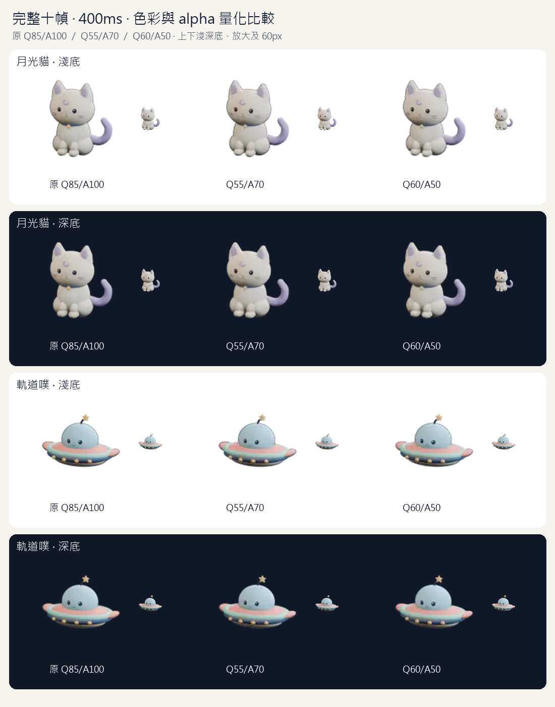
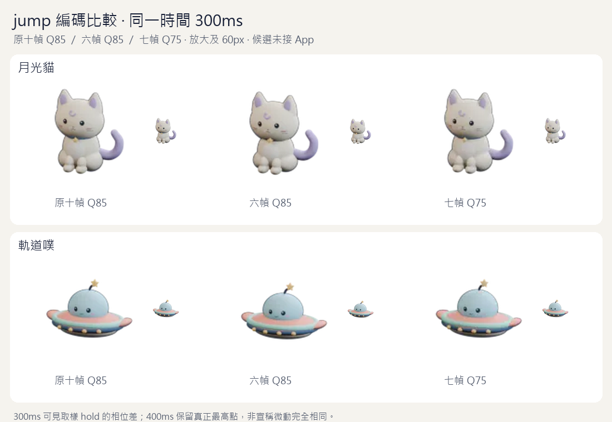
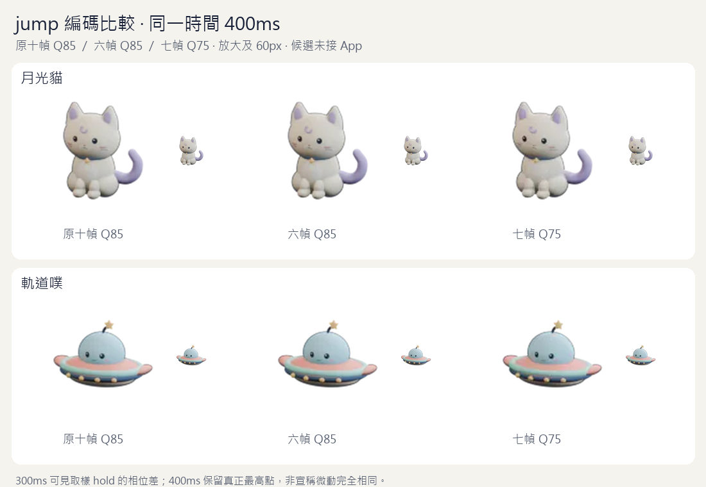

# jump 編碼與五態預算評估（DP-195，2026-10-24）

DP-194 的原 Q85 貓跳躍加入四態包後超出 192 KiB，這段依持續開發授權獨立評估編碼。**建議貓用完整十幀 Q55／alpha quality 70，飛碟保留 DP-194 完整十幀 Q85／alpha 100**，共用既有 idle PNG。兩款五態包為 **196,286／173,845 bytes**，仍在 196,608 bytes 內；App 尚未採用候選、沒有跳躍觸發。



交付八個候選 WebP、[逐時間點量測與 SHA](manifest.json)、[互動預覽](preview.html)與可重跑腳本。原 DP-194 Blender／PNG／WebP、既有四態 App 包與預算不變；沒有複製飛碟原 Q85 或 PNG。新編碼仍有損，新動作品質尚未經擁有者目視驗收。`eligible` 只表示通過本次體積與數值門檻。

## 比較方法與失敗方案

來源是 DP-194 的十張 120px 原始 PNG，每張 100ms，保留來源提交 `6d5a15e` 作 provenance。每個候選都真正解碼，對 **0、100、…、900ms 的原十個時間點**比對，而非只拿已選出的幀比較。RGBA 分別合成到 `#f5f3ee` 與 `#111827`，計算整張 RGB 平均絕對差／255；兩底最大值都須小於既有 0.008。逐解碼幀驗證 120／真正 LANCZOS 60px 的 8／4px 透明邊距、原生時長與單次播放。

| 方案 | 原幀 indices | 各幀 ms | 色彩／alpha quality |
| --- | --- | --- | --- |
| 原十幀 | 0–9 | 各 100 | 85／100 |
| 六幀 | 0、2、4、6、8、9 | 200、200、200、200、100、100 | 85／100 |
| 七幀 | 0、2、3、4、6、8、9 | 200、100、100、200、200、100、100 | 75／100 |
| 完整十幀 A | 0–9 | 各 100 | 55／70 |
| 完整十幀 B | 0–9 | 各 100 | 60／50 |

六／七幀保留最高點與回位、總時長也相同，但其他時間的姿態有差異。第一版 checker 實際拒絕減樣方案：貓六幀淺／深底最大差 0.01924／0.02363，七幀 0.01423／0.01623；飛碟六幀 0.02944／0.03360，七幀 0.02464／0.02641。未降低門檻或把相位差排除；這四個候選保留為 **不採用的比較資料**。單純把完整十幀色彩降到 Q45／40／35、alpha 100 時，貓仍為 18,844／18,504／18,110 bytes，超過 15,758 bytes 的剩餘空間，因此才評估 alpha 編碼。





完整十幀兩方案保持十個原取樣與各 100ms，但量化改變了色彩與半透明邊緣。A 的匹配幀 alpha 最大絕對差為兩款各 11／255；B 為貓 15／255、飛碟 16／255。A 保留較細的 alpha，故建議貓採 A。飛碟原 Q85 已符合預算，建議保留原編碼。這些整張畫布誤差不是感知等價、SSIM、解碼效能或耗電量，不能取代目視驗收。

## 實檔量測

| 角色／方案 | WebP bytes | 五態包 bytes | 淺底最大差 | 深底最大差 | 本輪門檻 |
| --- | ---: | ---: | ---: | ---: | --- |
| 貓原 Q85 | 26,058 | 206,908 | 0.003265 | 0.003263 | 體積超限 |
| 貓六幀 Q85 | 15,368 | 196,218 | 0.019241 | 0.023634 | 時間點差異超限 |
| 貓七幀 Q75 | 15,106 | 195,956 | 0.014228 | 0.016231 | 時間點差異超限 |
| **貓十幀 Q55/A70** | **15,436** | **196,286** | **0.004873** | **0.004731** | 通過，建議 |
| 貓十幀 Q60/A50 | 15,250 | 196,100 | 0.004923 | 0.004707 | 通過，備選 |
| **飛碟原 Q85** | **21,472** | **173,845** | **0.003782** | **0.003780** | 通過，建議保留 |
| 飛碟六幀 Q85 | 12,858 | 165,231 | 0.029444 | 0.033597 | 時間點差異超限 |
| 飛碟七幀 Q75 | 12,476 | 164,849 | 0.024640 | 0.026412 | 時間點差異超限 |
| 飛碟十幀 Q55/A70 | 12,762 | 165,135 | 0.005333 | 0.005238 | 通過，無須採用 |
| 飛碟十幀 Q60/A50 | 12,662 | 165,035 | 0.005098 | 0.004932 | 通過，無須採用 |

每個候選都比較 `minimize_size=False／True` 並選較小實檔，兩組 bytes 及選項保留在 manifest。五態包只增加一張 jump WebP，靜態共用已存在且與中性首末姿態 RGBA 相同的 idle PNG。`jump/trial_contract.py` 依已發布來源 hash 重建固定 DP-192 四態包，不讀未來可變的 App registry，也沒有放寬 192 KiB。

**貓採建議後只剩 322 bytes；這不表示完整七態已能裝入現有預算。** walk／sit 若需要新增圖片仍需先量測，不能直接擴充包或悄悄改四態畫質。下一段 DP-196 只接入候選與 typed jump registry、同 PNG／reduce／失敗回退，App 觸發政策再另段；不加 XP／偏好／schema。

## 驗證與重跑

PowerShell repo 根目錄，Python 3.12／Pillow 12.2.0：

```powershell
py -X utf8 -u docs/pet-concepts/2026-10-24/jump-encoding/build_candidates.py
py -X utf8 docs/pet-concepts/2026-10-24/jump-encoding/check_candidates.py
py -X utf8 docs/pet-concepts/2026-10-24/jump-encoding/test_controls.py
```

依序執行，不與 pack／預覽平行跑負控制。缺產物先失敗，減樣實際差異再失敗；完成後十項負控制：缺候選、靜態冒充、無限循環、錯時長、透明越界、總長不變但相位被改、末幀錯誤、偽造合格、漏最後 index、實檔超預算。最後一項在實檔追加 1,024 bytes 並同步 bytes／hash／總量及不合格標記，仍被總量守門拒絕。錯末幀控制最初先撞到舊體積 metadata，補同步 bytes／hash／總量後，仍由實際畫面差異拒絕。全部 finally 逐 byte 還原，正向驗收通過；舊來源 hashes 與原四態包都不變。

Browser plugin not available，沿專案 Playwright。兩個獨立 Chromium context（390×844、1280×900，實際 `Asia/Taipei`）確認 2 張原動畫＋8 個候選在放大／60px 都有畫面變化、1 秒後保持不動、可重播，靜態與 reduce 共用真正 idle PNG。深色無水平溢出，URL／title／非空白／無 Vite overlay、console／pageerror 均通過；完整比較板與瀏覽器截圖目視。QA 腳本／截圖在 `%TEMP%/daypop-dp195-*`，不能代替 iOS standalone、App 觸發或擁有者美術驗收。

本段只交試作候選、量測與交接；產品、0.4.3／v4／18 migrations、公告與部署不變。DP-171／172／041 未結案；最新版 PR 四項 CI 與審查全過才依既有授權合併。

本機 lint／typecheck、88 檔 1,389 單元＋27 Node、build／check:build 通過。JS 746,230 raw／219,796 gzip、CSS 112,388／27,272 bytes，現有 App 圖片 180,850／152,373 bytes，與前段相同；候選未進 dist。離線 Pillow 驗收在本機執行，沒有增加 CI 相依。

132 個本機 Markdown 連結通過。候選目錄要求精確八個實檔及各自固定路徑，建議保留的飛碟原圖也實查淺深底品質與總量；增補這些守門後十項負控制與完整正向驗收再次通過。

本段已對齊 DP-194 PR #189 合併後的最新 main `1227676`，沒有重送 Blender／PNG。該 PR head `6d5a15e` 的 run `40101980156` 四 CI 全過（Chromium 275 passed／13 skipped、WebKit 7 passed）；審查狀態停滯逾 9 小時，2026-10-25 以同一提交重新 Ready 後完成無發現、無未解決討論，才依授權合併。來源製作時的 SHA 保留不改，本 PR 仍須自己的最新 head CI／審查。
