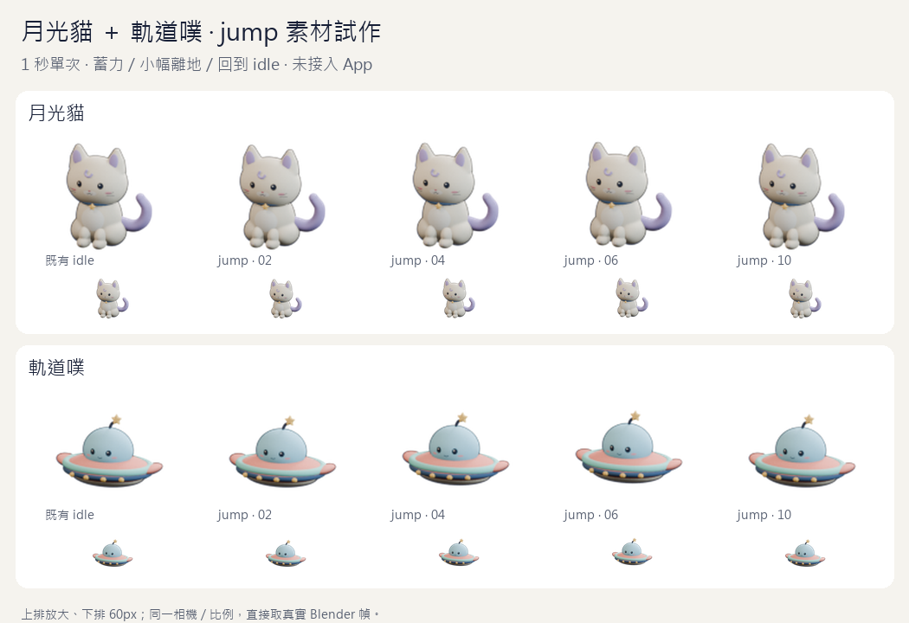
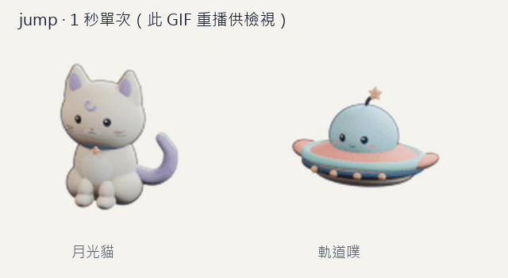
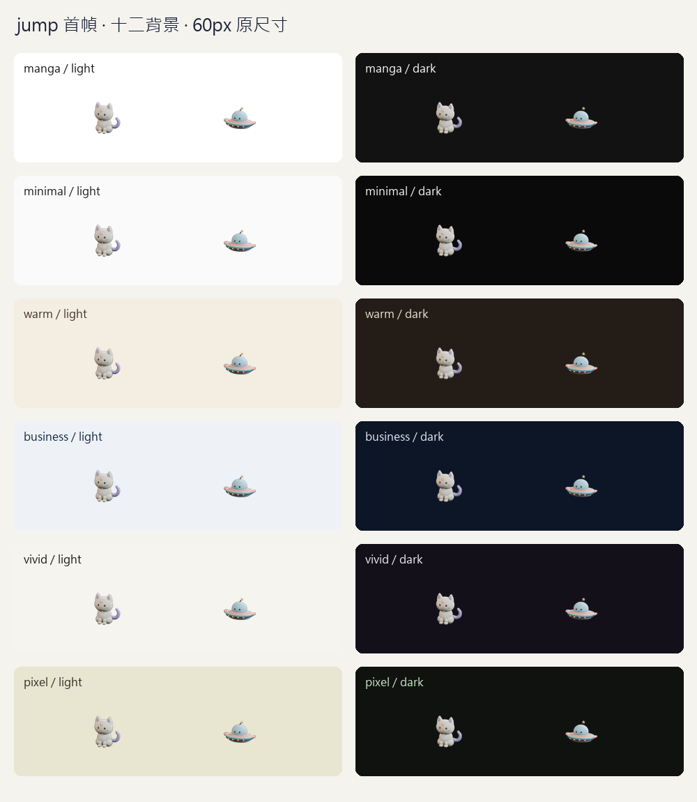

# 月光貓＋軌道噗 jump 素材試作（DP-194，2026-10-24）

沿擁有者持續開發／逐段 PR／四項 CI 與審查通過後合併的授權，從 DP-171 拆出約 **1 秒單次** 的蓄力、輕躍與回原姿態。這是 agent 提出的動作試作，**新動作尚未獲擁有者目視驗收，也未接 App**。貓保留坐姿與短肢，飛碟維持無腿懸浮生物；沒有新增造型或特效。



交付兩份可編輯 [月光貓](source/moon_cat.blend)／[軌道噗](source/orbit_ufo.blend) Blender、20 張 120px 透明 PNG、兩張靜態替代、無損／Q85 WebP、[量測與 SHA-256](manifest.json)、[互動預覽](preview.html)。本機 Vite 預覽路徑為 `http://127.0.0.1:4173/docs/pet-concepts/2026-10-24/jump/preview.html`；GitHub 不直接執行 HTML。



## 原生動作與邊界

- 重用 DP-187 [三態來源](../../2026-10-23/motion/README.md)，原 mesh／curve／shape-key 幾何、材質 shader nodes／links／參數、相機矩陣／比例與基準 anchor 不變。動作以 `CTRL / …` 的 delta transforms 及既有耳朵 shape key 製作，眼睛保持張開。
- Timeline 1–10、10fps。第一與第十個原生姿態等於原 idle 第一幀；真正渲染的首末 RGBA 也逐像素等於原 idle。沒有把末幀替換成舊 PNG 來假造回位。靜態替代逐 byte 複製新首幀；它與原 idle 的 PNG 壓縮／metadata bytes 不同，但解碼 RGBA 相同。
- 貓在蓄力時身體壓縮 10%、頭略低，輕躍 root delta Z 最多 0.03；飛碟壓縮 4.5%、delta Z 最多 0.10，天線略擺。數字是 Blender 場景單位，不是 App 位移量。全段 anchor 基準不改，回原位後不留下變形。
- 每張原圖及兩種 WebP 解碼幀都驗證 120px 四周至少 8px 全透明，真正 LANCZOS 縮成 60px 後至少 4px。首輪貓最高點縮圖只餘 3px，上限檢查先失敗；縮小新動作抬升與耳朵反應後重新渲染，未調相機／角色比例或降低門檻。
- 分支準備時 main 是 `b159045`，#188 等 CI 時暫接 DP-193 的 `2289711`；這個 SHA 是製作時的 provenance，不因後續 rebase 改寫。舊 DP-185／187／190／191 產物與 `src/assets/pets/` 不變。

## 實際編碼與既有預算

| 角色 | 10 張 PNG bytes | 無損 WebP bytes | Q85 WebP bytes | 靜態 PNG bytes |
| --- | ---: | ---: | ---: | ---: |
| 月光貓 | 135,017 | 71,998 | 26,058 | 13,579 |
| 軌道噗 | 102,696 | 58,308 | 21,472 | 10,325 |

兩種 WebP 都實際解碼為 10 幀、1,000ms、`loop=1` 單次。無損與 PNG 的合成 RGB 完全一致；Q85 在 `#f5f3ee` 上合成後，整張 RGB 平均絕對差／255 的最大值為貓 0.003265、飛碟 0.003782。此指標不代表感知等價、真機解碼速度或耗電。

| 角色 | 現有四態包 | 加 Q85、共用原 idle PNG | 加 Q85 與獨立 PNG | 每款上限 |
| --- | ---: | ---: | ---: | ---: |
| 月光貓 | 180,850 | **206,908** | **220,487** | 196,608 |
| 軌道噗 | 152,373 | 173,845 | 184,170 | 196,608 |

即使共用 idle PNG，貓仍超過 192 KiB **10,300 bytes**。因此本段保留候選，不增加 App 圖片或放寬預算；下一段先評估單次動作的編碼／時序與五態合併預算，再決定可接入的包。直接降低整段採樣可能削弱短動作的蓄力／落地，不能只看總秒數。App 觸發政策另段，沒有待辦獎勵或 XP。

`trial_contract.py` 從已發布 DP-187／190／191 manifest 的六個實檔與 SHA 重建 DP-192 混合包，固定本輪比較基線；未來 App 增加狀態時不會悄悄改寫這張歷史表，也不依賴新狀態的 registry。

## 驗證與重跑

PowerShell repo 根目錄，官方 portable Blender 5.2.3 LTS、Python 3.12／Pillow 12.2.0：

```powershell
$jumpBlender = 'C:\Users\memor\AppData\Local\Temp\daypop-blender-5.2.3\blender-5.2.3-windows-x64\blender.exe'
& $jumpBlender --background --factory-startup --disable-autoexec --python-exit-code 1 --python docs/pet-concepts/2026-10-24/jump/create_jump.py
py -X utf8 docs/pet-concepts/2026-10-24/jump/pack_jump.py
py -X utf8 docs/pet-concepts/2026-10-24/jump/check_jump.py
& $jumpBlender --background --factory-startup --disable-autoexec --python-exit-code 1 --python docs/pet-concepts/2026-10-24/jump/check_sources.py
py -X utf8 docs/pet-concepts/2026-10-24/jump/test_controls.py
& $jumpBlender --background --factory-startup --disable-autoexec --python-exit-code 1 --python docs/pet-concepts/2026-10-24/jump/test_source_controls.py
py -X utf8 docs/pet-concepts/2026-10-24/jump/check_jump.py
```

**依序執行。** 負控制會暫時破壞真正產物，不可與另一組負控制／pack／預覽並行。首輪兩組同時執行時，圖片 checker 讀到原生負控制尚未還原的來源而失敗；原生 finally 已精確還原後，改依序重跑圖片七項與完整正向驗收通過。生成器完成後才 pack，重建需重新量測與驗收，不能只更新 hash。

圖片 checker 在尚無產物時先失敗，首輪實際縮圖留白也先失敗。七項圖片負控制：凍結 PNG、1-alpha 越界、缺靜態替代、錯誤原生 WebP 時長、靜態 WebP、無限循環、錯誤末幀；四項 Blender 負控制：相機意外加動畫、中途閉眼、改材質粗糙度、末幀未回原位。均被拒絕並 finally 逐 byte 還原；原生兩份來源重開，核對模型／材質、十個固定相機／anchor 樣本、真正抬升／壓縮、至少六種姿態與原始中性首末幀。來源 provenance 亦與已發布 DP-187 manifest 的 SHA 比對，沒有只信新 manifest。

Blender 在沙盒內寫工作目錄外的 `.thumbnails` 預覽會報 OpenImageIO warning；兩份正式 `.blend` 與全部 PNG 已成功寫出，重新開啟來源與 hashes／正向驗收通過。沒有為此改系統權限或另裝 Blender。

Browser plugin not available，使用專案 Playwright。獨立 Chromium 390×844／1280×900 context（實際 `Asia/Taipei`）確認兩角色原生 Q85／無損在放大與 60px 都有畫面變化，播放完成後保持不動、按重播改用新播放 URL；PNG 幀輪轉後停在真正 `009.png`。靜態開關與 reduced-motion 使用 PNG，深色背景不溢出。URL／title／非空白／無 Vite overlay、console／pageerror 皆通過；已目視關鍵幀、十二背景與兩尺寸截圖。QA 腳本／截圖留 `%TEMP%/daypop-dp194-*`。這是素材預覽，不是 App 觸發、axe、iOS standalone 或擁有者美術驗收。



本段不改產品程式、圖片包／registry／worker、Auth、0.4.3／資料 v4／18 migrations、公告或部署。DP-171／172／041 仍未結案；最新版 PR 四項 CI 與審查都通過後才依授權合併。

本機 lint／typecheck、88 檔 1,389 單元＋27 Node、build／check:build 通過。產品輸出仍 JS 746,230 raw／219,796 gzip、CSS 112,388／27,272 bytes，與前段 DP-193 相同；圖片仍為貓 180,850／飛碟 152,373，這批文件候選未進 dist。Blender／Pillow 驗收在本機執行，沒有增加 CI 相依。

前段 PR #188 head `2289711` 已四項 CI 全過、完成審查無發現且無未解決討論，合併為 `67d8ea8`（run `40100232030`，Chromium 275 passed／13 skipped、WebKit 7 passed）。本段已 rebase 到該最新 main，不重送睡眠產品程式；131 個本機 Markdown 連結通過。本 PR 的最新 head 仍需自己的四項 CI 與審查。
