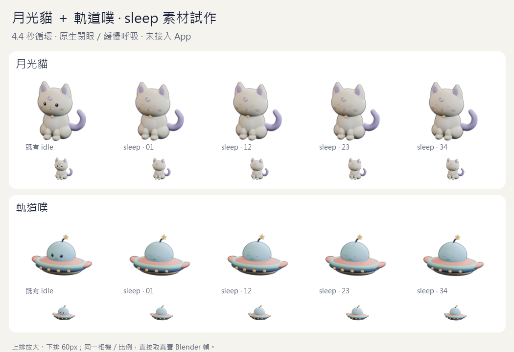
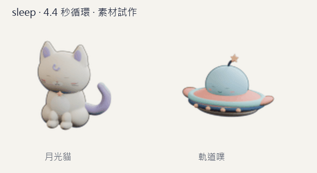
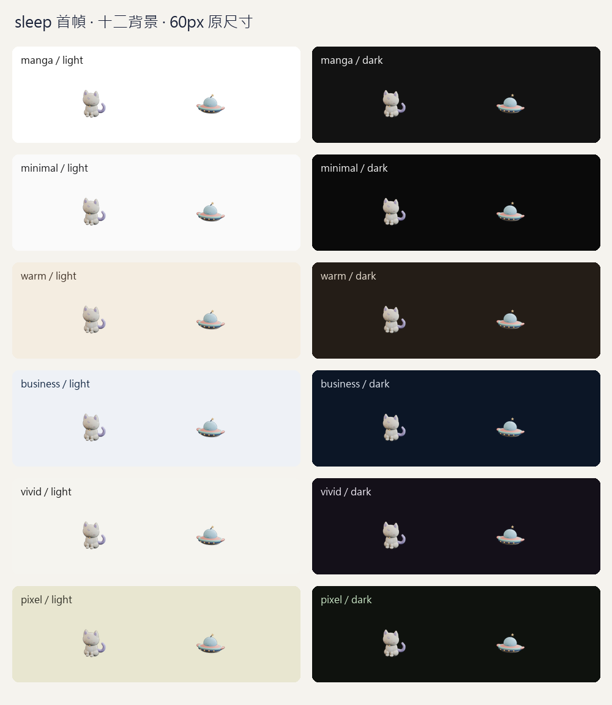

# 月光貓＋軌道噗 sleep 素材試作（DP-190，2026-10-24）

依擁有者「逐段開發／PR／CI 與審查過後合併，再持續」授權，從 DP-171 的剩餘素材拆出 `sleep`。本段由 agent 沿已採用造型提出並製作：閉眼、緩慢呼吸／懸浮的 **4.4 秒循環**，沒有 Zzz、特效或造型重設計。**sleep 動作品質尚未經擁有者目視驗收，也未接入 App**；不代表完整七態已完成。



交付兩份原生可編輯 Blender、88 張透明 PNG、兩張靜態替代、無損／Q85 WebP、[互動預覽](preview.html)及 [manifest／SHA-256／量測](manifest.json)。互動頁由本機 Vite 提供，例如 `http://127.0.0.1:4173/docs/pet-concepts/2026-10-24/sleep/preview.html`，GitHub 不會直接執行 HTML。預覽支援 PNG 幀、兩種編碼、暫停、reduced-motion、深色與原尺寸並排。



## 原生來源與尺寸

- [月光貓](source/moon_cat.blend)／[軌道噗](source/orbit_ufo.blend)由 DP-187 [三態來源](../../2026-10-23/motion/README.md)增量製作；三態舊檔、DP-185 造型和 `src/assets/pets/` 不變。來源基線是 `868fdbb`；PR #184 等 CI 時獨立準備，本項發 PR 前再對齊合併後 main，來源 SHA 不因此改寫。
- 保留原 mesh／材質、相機矩陣／ortho scale、基準 anchor。重用 `CTRL / …` 與真正的 `Blink` shape keys，沒有把原始動畫變成貼圖影片。sleep timeline 1–44、45 為相同姿勢的 keyed 循環邊界；10fps 沿三態試作採樣。閉眼保持全段、貓小幅呼吸與尾尖、飛碟天線降低且小幅懸浮。
- 每張 120×120 RGBA，逐幀四周至少 8px 全透明；真正 LANCZOS 縮成 60px 後至少 4px。取景完全沿既有三態，沒有為過驗收放大留白或降低門檻。靜態替代是各段首幀的精確副本。
- 新 `.blend` 逐一重開，以 45 個樣本核對固定相機／基準 anchor、真正閉眼、可編輯動作、循環邊界，以及原 mesh／材質完全一致。manifest 保留舊來源／idle 首幀 SHA-256，沒有覆寫歷史三態 manifest。

## 實際量測與接入界線

| 角色 | 44 張 PNG bytes | 無損 WebP bytes | Q85 WebP bytes | 靜態 PNG bytes |
| --- | ---: | ---: | ---: | ---: |
| 月光貓 | 582,239 | 303,272 | 107,120 | 13,252 |
| 軌道噗 | 450,618 | 252,928 | 93,440 | 10,254 |

兩種編碼都實際解碼為 44 幀、4,400ms、無限循環，解碼後仍符合 120px 透明邊距。無損解碼與原 PNG 合成 RGB 一致；Q85 在 `#f5f3ee` 上合成後、整張 RGB 平均絕對差／255 的最大值：貓約 0.00300、飛碟約 0.00349。這不是感知等價、SSIM、瀏覽器解碼速度或真機耗電量。

若直接把 Q85＋新靜態圖加入 DP-188 的原包，會得到貓 **298,162 bytes**、飛碟 **255,147 bytes**，都超過既有每款 **192 KiB＝196,608 bytes**。因此本段只交素材與量測，App 資產、registry、`performance-budget.json` 與 worker 不變。下一段先量四態編碼的體積／畫質與時序，再決定可接入的包；睡眠觸發政策另段處理。預覽檔不是預載包。

## 驗證與可重跑命令

PowerShell repo 根目錄（本機已核對官方 portable Blender；`py` 使用 Pillow 12.2.0）：

```powershell
$sleepBlender = 'C:\Users\memor\AppData\Local\Temp\daypop-blender-5.2.3\blender-5.2.3-windows-x64\blender.exe'
& $sleepBlender --background --factory-startup --disable-autoexec --python-exit-code 1 --python docs/pet-concepts/2026-10-24/sleep/create_sleep.py
py docs/pet-concepts/2026-10-24/sleep/pack_sleep.py
py docs/pet-concepts/2026-10-24/sleep/check_sleep.py
& $sleepBlender --background --factory-startup --disable-autoexec --python-exit-code 1 --python docs/pet-concepts/2026-10-24/sleep/check_sources.py
py docs/pet-concepts/2026-10-24/sleep/test_controls.py
& $sleepBlender --background --factory-startup --disable-autoexec --python-exit-code 1 --python docs/pet-concepts/2026-10-24/sleep/test_source_controls.py
```

依序執行；負控制會暫時變造真正產物，不與繪板／量測／預覽平行跑。checker 在缺少產物時先失敗；完成後凍結真實 PNG 幀、1-alpha 越界、缺靜態替代、錯誤原生 WebP 時長、靜態 WebP 冒充動畫五項均被拒絕。原生來源另測相機意外加動畫、某幀張眼、改動材質粗糙度三項，直接讀交付 `.blend` 的 mesh／curve／shape key 幾何與 shader nodes／links／參數，不是掃生成器字串。八項全以 finally 精確還原，重新核對 hashes／全部正向驗收通過。重建可能因 Blender／Pillow 平台差異改變少量 bytes，需重新 pack／量測／驗收，不能只改 hash。

Browser plugin not available，沿專案 Playwright；獨立 Chromium context（390×844、1280×900，實際 `Asia/Taipei`）確認兩角色兩種原生 WebP 畫面會改變、PNG URL 幀輪轉、暫停／reduced-motion 使用真正靜態 PNG、深色無水平溢出。URL／title／非空白／無 Vite overlay、console／pageerror 均通過；腳本與截圖留在 `%TEMP%/daypop-dp190-*`。已目視關鍵幀、十二背景與手機／桌面截圖。這不是 App 新狀態、axe 或 iOS standalone 驗收，也不能取代擁有者美術驗收。



本段未接睡眠時間表、自動走動、待辦回饋、選角／偏好或 XP。DP-171／172／041 仍未結案；0.4.3／資料 v4／18 migrations、公告與部署不變。

離線 Blender／Pillow 驗收在本機執行，沒有增加 CI 相依。前段 DP-189 PR #184 的 head `4bf02cc` 已四項 CI 過、審查無發現後合併 `cf79edf`（run `40059989953`；Chromium 271 passed／13 skipped、WebKit 6 passed）；本分支已對齊該最新 main，保留來源製作時的 `868fdbb` 作 provenance。

該基底的最終 lint／typecheck、1,382 單元＋24 Node、build／check:build 與 32 個本機 Markdown 連結通過；App 仍貓 177,790／飛碟 151,453 bytes，JS 744,986 raw／219,439 gzip、CSS 112,388／27,272，與只含 DP-189 的產品輸出一致。本段最新 head 四項 CI 與審查過後才依授權合併，沒有部署。
