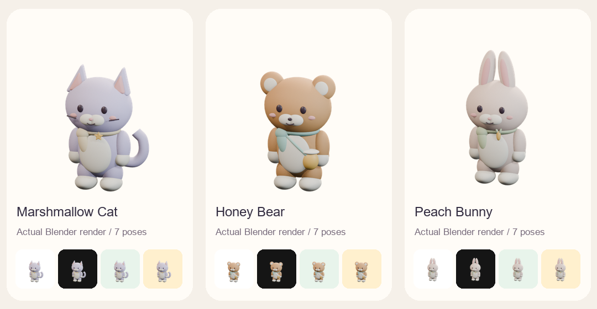

# 三款 Blender 夥伴（DP-238）

> 後續本機候選已接 [可保存選擇](../../pet-selection.md) 與 [前景自主活動](../../pet-autonomy.md)，尚未合併／發布。11-05 擁有者另請網頁版繼續三款 Blender 造型；來源與整合順序見 [交接](../../pet-handoff-2026-11-05.md)。本頁下方「尚未接線」描述 DP-238 素材階段。

2026-11-04，依擁有者「至少三種精緻桌寵、可以切換、活潑且自主走動」的新委託製作。採同一套柔和霧面 3D 風格：棉花貓、蜂蜜熊、蜜桃兔，以耳朵／尾巴／配件形成不同輪廓；原本已採用的月光貓與飛碟素材及歷史證據完整保留。



這一段交付三份可編輯模型、每款七態與 App 素材 registry；**設定切換與自主移動尚未接線**。偏好需依既有 DP-172 的 v5／write barrier／資料遷移規劃獨立處理，不另存一份臨時 pet choice；後續活動需保留手動位置、表單避讓、背景／reduced-motion 暫停與既有互動。不得把有 walk 素材當成已會自行走動。

## 來源與重建

使用 [Blender 官方 Windows portable 5.2.3](https://download.blender.org/release/Blender5.2/)，zip SHA-256 與既有官方記錄一致：`723f08a4401502561eb763cdeacf8745b31e5f3f154d287d3830d97cf75dc2fb`，實際版本 5.2.3 LTS／build e13b728c6880。舊暫存目錄缺少 DLL，重新下載核對並解壓至系統暫存；不改系統設定，也不提交 Blender 執行檔。

`create_collection.py` 以原生可編輯 meshes、curves、具名材質、三盞柔光與正交相機建模；沒有外部模型、貼圖或生成圖片。圍巾、星星、蜜罐、胡蘿蔔均為實際立體幾何。八個全身／軀幹／頭／肢體／尾巴控制器與兩個眼睛控制，逐幀保存 location／rotation／scale；timeline 明確標記 idle、walk、look、sit、sleep、jump、grab 七段，共 50 幀。不是對單張圖片施加 CSS 變形。

```powershell
$petBlender = 'C:\path\to\blender.exe'
& $petBlender --background --factory-startup --disable-autoexec --python-exit-code 1 --python docs/pet-concepts/2026-11-04/create_collection.py -- --preview
& $petBlender --background --factory-startup --disable-autoexec --python-exit-code 1 --python docs/pet-concepts/2026-11-04/create_collection.py
& $petBlender --background --factory-startup --disable-autoexec --python-exit-code 1 --python docs/pet-concepts/2026-11-04/check_sources.py
py -3.12 docs/pet-concepts/2026-11-04/package_collection.py
Copy-Item docs/pet-concepts/2026-11-04/package/* src/assets/pet-collection/
```

模型在 `source/`，150 張實際原生影格在 `renders/`，27 份封裝在 `package/` 與 App `src/assets/pet-collection/` 逐 byte 相同。打包只需要 Pillow（本機 12.2.0）；不重新繪製寵物。Blender／GPU 取樣可能造成少量差異，重建後須重跑來源／素材檢查及更新雜湊，不保證逐 byte 可重現。

## 格式與驗證

120×120 RGBA 輸出、60×60 顯示，每張原生與 decoded WebP 影格四邊至少 8px 全透明。相機在每款的七態間固定；兔子另預留長耳與跳躍的空間。idle 2,160ms／walk 800ms／sleep 2,400ms 循環；look 1,600ms／jump 1,000ms 單次；idle／sit／sleep／grab 有真正 PNG，供暫停及 reduced-motion 使用。WebP quality 85／method 6 有損編碼，尚未宣稱感知無損。

| 夥伴 | 九份 App 檔合計 | 原每款上限 |
| --- | ---: | ---: |
| 棉花貓 | 118,654 bytes | 196,608 bytes |
| 蜂蜜熊 | 119,107 bytes | 196,608 bytes |
| 蜜桃兔 | 103,265 bytes | 196,608 bytes |

沿用原 idle／look／sleep／jump／PNG 個別預算；新增 walk 沿 look 的 49,152 bytes 上限，沒有放寬預算。`manifest.json` 記錄封裝、來源 hash、影格數與時長；`source-proof.json` 來自重新開啟實際三份 .blend，檢查原生動畫、具名七段、可編輯 meshes 及無外部貼圖。第一版 checker 抓到場景切換殘留 timeline marker，已修正清理後重建三款，沒有放寬七段契約。

Node 守門核對 27 個 App 與來源封裝檔、三個 native proof／來源 hash、缺 walk／改 bytes／超過每款預算拒絕；原兩款五態來源驗證保留。新增 component 回歸驗各新款 walk WebP 可換成 reduced-motion 真正 PNG。瀏覽器以實際 compositor 的圖片截圖比較確認 walk 像素變化；第一版 canvas drawImage 只能取得預設影格，兩個 Chromium 案例因此失敗，改成沿既有 idle 回歸的真實截圖方法後，Chromium 手機／桌面與 WebKit 三項均通過，未改動動畫／門檻掩蓋失敗。

完整 1,805 單元＋41 Node、lint、TypeScript／明確 Pages production build／check:build 通過；JS＋worker 797,966 raw／235,888 gzip、CSS 121,024／29,600，原預算／CSP 不變。既有寵物素材互動 Chromium 十二項通過；新三平台素材驗證三項通過，三份七態截圖已目視（兩輪合計十五個不同案例通過，不宣稱首輪十四項全綠）。實際單元 Etc/GMT-8／browser Asia/Taipei。Browser plugin／Chrome access host 不可用，採 repo Playwright；不是 iPhone standalone 真機驗收。最新 head 自己四 CI／同 head 完成審查仍須通過，PR 建立因 Chrome 連線受阻，尚未合併。

目前 App／使用者 schema 仍 0.4.7／v4，沒有 migration 或正式部署。此段與 DP-236 手機外層修正分開；原機縮放／頂部問題的驗證界線見該分支。
