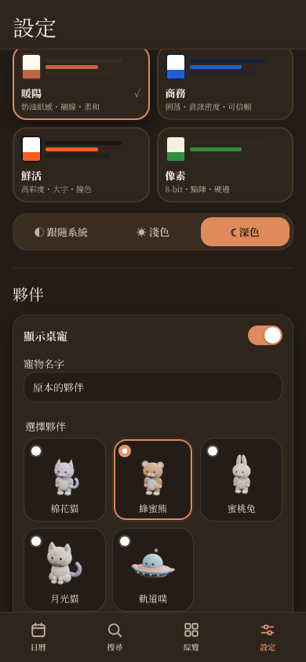

# 夥伴選擇與 v5 偏好（DP-239）

2026-11-04 製作，11-05 接續完成 production 驗證。依擁有者「至少三種精緻夥伴、在設定切換」委託，接 DP-238 的棉花貓／蜂蜜熊／蜜桃兔，保留月光貓與軌道噗；使用 `petKind` canonical 偏好保存，沒有第二個臨時 storage key。此段不包含自主走動（DP-240）。

## 資料與相容界線

- user-data v4→v5：v1／v2／v3 沿原遷移補入夥伴，v4 只新增預設月光貓；既有主題、名字、開關、列數、行程與待辦不變，revision／updatedAt 不因遷移增加。current v5 必須有有效 key，非法／null 不會被預設值掩蓋。
- 提升前在 v4 設定下驗證 guest 偏好及帳號快取的較新 envelope 保護，四個選中案例通過。guest 每次修改仍重讀 write barrier；新增帳號 cache 寫入時拒絕 future envelope，不會降版覆寫。本次防護不會回溯改寫已發布的舊程式；帳號 cache 仍只是 fallback，Supabase 才是 durable store。remote 已確認但 cache 寫入被拒時可能回報錯誤，沿既有 quota 行為，不承諾跨分頁原子 CAS。
- JSON 備份格式升至 v2，包含選擇；v1 仍可匯入並補月光貓，future／非法 choice／v2 缺欄位拒絕。舊 App 會拒絕較新備份格式，避免把選擇當成不存在。legacy `calpet.v2` 的 wire allowlist／fingerprint 與原資料保留，不把新欄位塞進舊一次性 RPC。
- 第 23 份 migration `20261104143910_pet_partner_preference.sql` 增加 `user_preferences.pet_kind`（五值 CHECK／非 null／預設月光貓），保留原 owner RLS／grants；更新既有 invoker replace RPC 的 key 驗證及 assignment。原八個 key 仍全部必填，只讓新增 key 對舊 client 可省略，省略時保留目前選擇；顯式 null／未知 key 拒絕。其餘 22 份不變。
- 設定使用原生 radio／fieldset，可用鍵盤；只在 confirmed repository 回應後顯示已保存的選擇。離線尚未看過的預覽用靜態占位，選擇仍可用，不為五張未快取 PNG 發出必敗請求。App 本身的圖片解碼／失敗 fallback 沿既有行為。

資料型別由新建、無 link 的 `DayPopPets` 本機隔離 stack 產生，generated types 只多三處欄位，不手改。API／DB 固定 57321／57322，提醒回歸只新增該明確 container／port 配對，仍拒絕其他目標。九組 HTTP 的假帳號皆清除；11-05 核對 users／calendars／events／todos／devices 各 0，stack 已停止。

## 驗證

11-04 完整 1,817 單元（103 檔）＋41 Node、lint、TypeScript／Pages build／check:build／23 檔 migration 結構檢查通過；JS＋worker 800,104 raw／236,629 gzip、CSS 121,824／29,760，原預算與 CSP 不變。11-05 新增 production 案例後 lint／typecheck 再確認。實際 Node Etc/GMT-8；browser Asia/Taipei，翻月回歸另明確列印 America/New_York。

本機 reset／全部 478 pgTAP、真正 Auth／HTTP 新偏好 **9/9**、原家庭分享 **17/17**、原提醒 **23/23** 均通過。涵蓋所有五值獨立 reload、非法／null 約束、兩帳號隔離及匿名拒絕、舊 client upsert／缺新 key 的匯入保留選擇、新備份還原與非法匯入完整 rollback。成功 replace 沿原協定重建列時間戳，因此其成功比較排除 createdAt／updatedAt；一般選擇與拒絕操作仍比較完整資料。local security advisors 無發現。CI database job 加入相同新 HTTP script；部署 workflow 使用同一組 CI gate。

新選擇流程 Chromium 手機／桌面與 WebKit **3 passed**：五款切換、reload、radio 鍵盤與其他資料不變，三張截圖目視。WebKit 首輪在資料載入前立即量 storage 失敗，改成等待相同完整預期資料，原期限不變。11-05 真正 production build 再 **2 passed**：完整 v4 fixture→v5、只改所選夥伴與顯示開關、圖片及 worker 控制 reload／精確 bytes 保留。這是本機 production fixture，非真正公開 0.4.7 自動升級或 iPhone standalone 驗收。

既有相關矩陣首輪 40 項為 36 passed／3 failed／1 skipped。兩個 production 首次離線設定揭露未快取 PNG 請求，已改離線占位；一個 JSON 拒絕案例有 `ERR_SOCKET_NOT_CONNECTED`，期間亦曾切換驗證用 Vite schema 設定，不把這輪算全綠。修正後停止變更設定，四個受影響手機／桌面案例原斷言重跑全過；共 39 個不同案例各過，不宣稱一輪完整矩陣全過。既有現行資料 fixture 改為 v5，真正 v4 遷移 fixture 明確保留；備份輸出斷言改 v2，資料／焦點／console 門檻未放寬。

第一輪 HTTP 在第六組抓到新 key 與舊八欄數量檢查衝突，已修正後重新 reset；其後又確認成功 replace 的差異僅列時間戳，按既有協定修正新測試，未改產品還原語意。前次清理因自動審核額度未執行，11-05 原操作重新授權執行成功，沒有繞過審核。

## 合併及發布

此分支接 `feat/dp-238-pet-collection`，待素材 PR 合併後再依序合併；自己的最新 head 四 CI／同 head 完成審查及討論全解仍須通過。Chrome browser access host 11-05 仍不可用，PR 建立暫受阻。沒有正式 migration、release version／歷史公告修改或部署。依 DP-172，**正式套用此 migration 必須先於 v5 前端發布**，現有提醒後端授權不延伸到此新 migration；先完成候選審核再放行。
